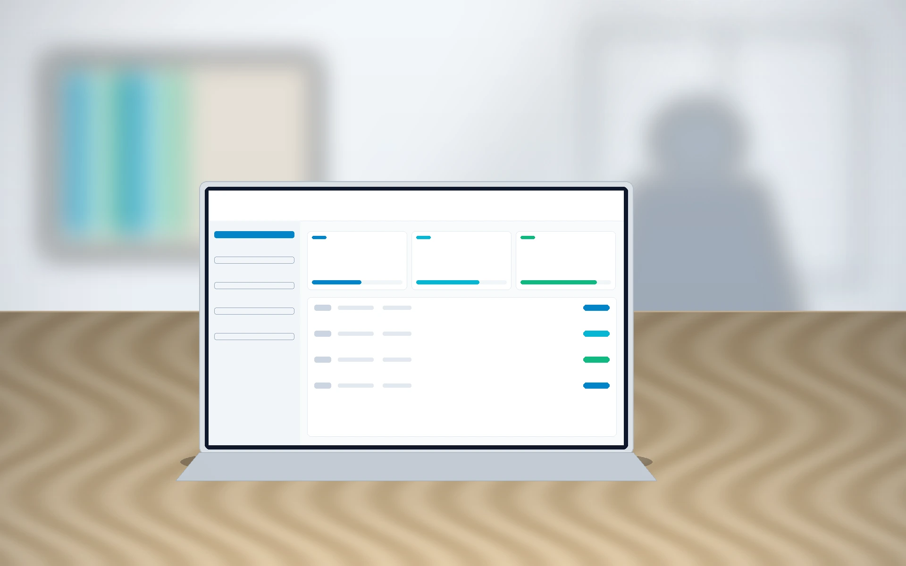
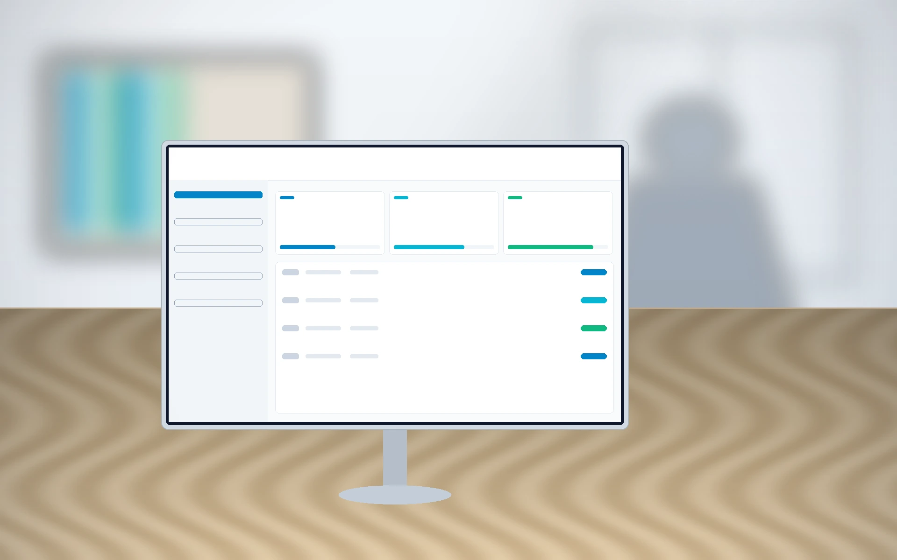
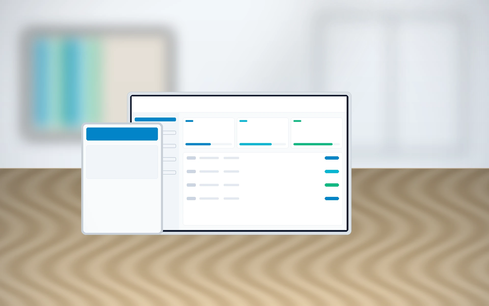
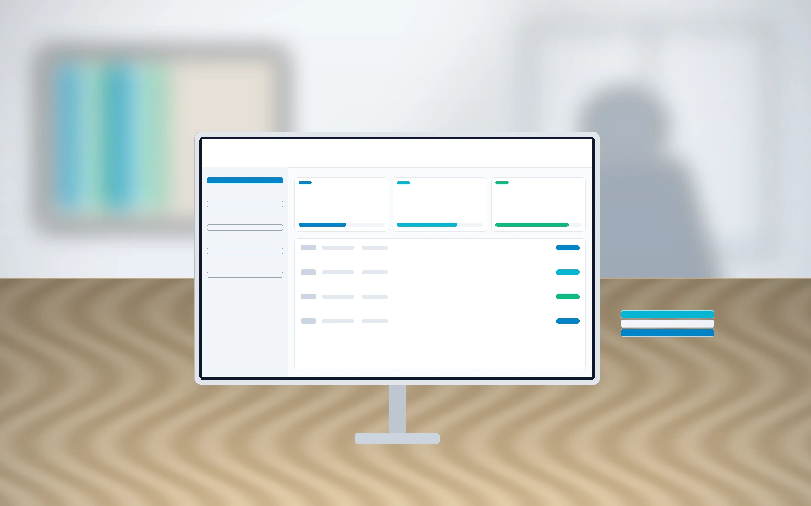
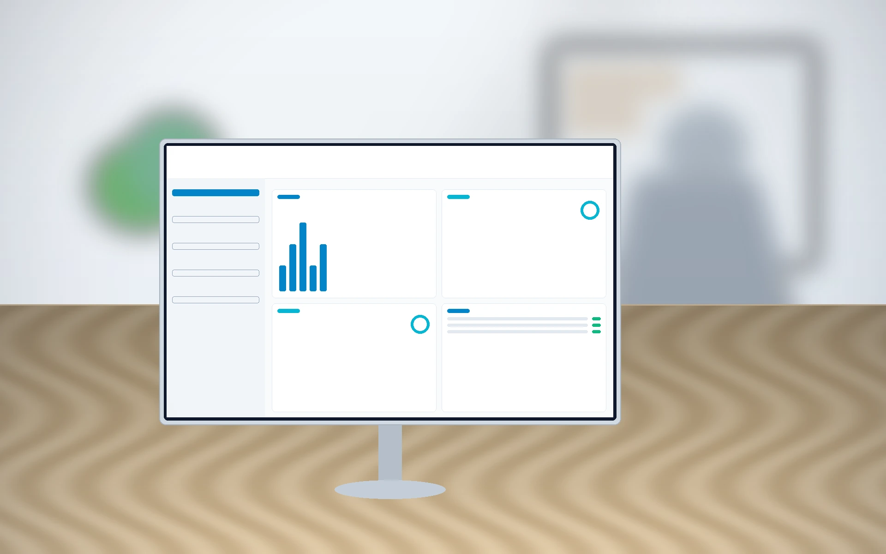
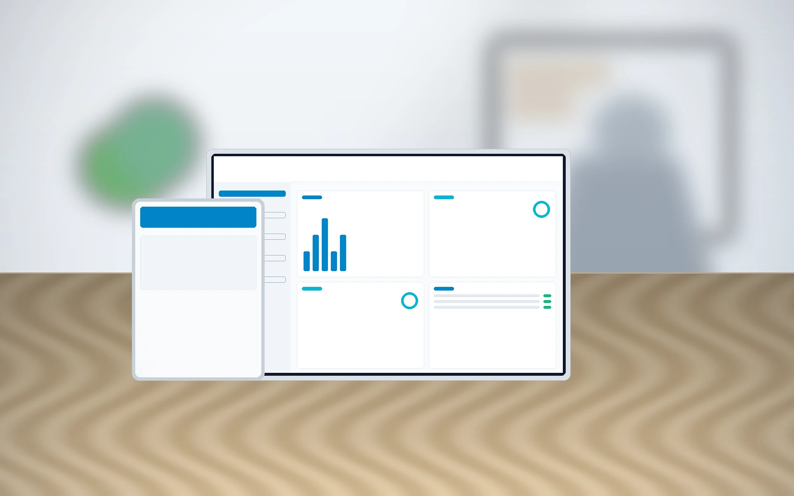

# QA visual — variantes regeneradas EduPay y Sistemas para Pymes

> **Snapshot histórico del pase V5–V8:** Batch 2 contiene 26 variantes en total. Esta acta conserva la evaluación de EduPay V5–V8 y Sistemas para Pymes V5–V8; no sustituye el inventario completo. EduPay V9/V10 se revisan en `EDUPAY_V9_V10_REJECTION_REPORT.md` y están rechazadas. EduPay y Sistemas para Pymes siguen sin ganadora.

Fecha de revisión: 2026-07-21  
Alcance: únicamente EduPay V5–V8 y Sistemas para Pymes V5–V8.  
Referencias positivas: Home Hero, Booking Hero, EAM Hero, Ecosistema de Productos V2 y Páginas Web V2.

## 1. Resumen general

Ninguna de las ocho variantes alcanza el estándar visual aprobado para BaseLogic. Todas comparten el mismo problema estructural: son composiciones de apariencia ilustrada/3D, con dispositivos simplificados sobre un fondo de oficina fuertemente desenfocado. La familia aprobada, en cambio, se construye desde fotografía editorial realista, luz natural, presencia humana u operación material creíble y tecnología integrada en una escena cotidiana.

Los assets nuevos cumplen bien las restricciones mecánicas de no incluir texto legible, números, logos o marcas. Sin embargo, fallan en los criterios más importantes de dirección de arte, fotorealismo, especificidad del concepto y compatibilidad con “Pragmatismo Iluminado”.

- **EduPay:** la UI de estados y barras de progreso puede sugerir seguimiento, pero no comunica pagos ni cobranza con suficiente especificidad y no contiene una señal educativa sutil. Se lee como un administrador SaaS genérico.
- **Sistemas para Pymes:** la UI se reduce a gráficos y tarjetas de analítica. No muestra clientes, inventario, pedidos, tareas ni operación real; se acerca al dashboard corporativo que debía evitarse.
- **Responsive:** el crop centrado funciona mejor en V5. V6 y V8 pierden bordes y elementos secundarios; V7 destruye el único rasgo diferenciador al cortar el dispositivo frontal. Ningún ajuste de `object-position` corrige el problema de dirección de arte.

### Método de puntuación

Cada criterio se puntúa de 1 a 5. El máximo es 75. En “Anatomía correcta” se asigna **3 neutral** a todas las variantes porque no hay personas, manos ni rostros que permitan validar anatomía; su ausencia evita el defecto, pero no demuestra calidad anatómica.

Abreviaturas de las tablas: **BL** BaseLogic; **PI** Pragmatismo Iluminado; **Ed.** calidad editorial; **Foto** fotorealismo; **No stock** ausencia de look stock; **Concepto** claridad; **UI** UI abstracta sin texto; **No logos** ausencia de marcas; **Anat.** anatomía; **Obj.** coherencia física; **Desk.** composición desktop; **4:5** crop mobile; **1:1** crop cuadrado; **Espacio** espacio útil; **Compat.** coherencia con aprobados.

## 2. Tabla de puntuaciones — EduPay V5–V8

| Variante | BL | PI | Ed. | Foto | No stock | Concepto | UI | No logos | Anat. | Obj. | Desk. | 4:5 | 1:1 | Espacio | Compat. | Total / 75 |
|---|---:|---:|---:|---:|---:|---:|---:|---:|---:|---:|---:|---:|---:|---:|---:|---:|
| EduPay V5 | 2 | 1 | 2 | 1 | 1 | 3 | 5 | 5 | 3 | 4 | 3 | 3 | 4 | 2 | 1 | **40** |
| EduPay V6 | 2 | 1 | 2 | 1 | 1 | 3 | 5 | 5 | 3 | 3 | 2 | 2 | 2 | 1 | 1 | **34** |
| EduPay V7 | 2 | 1 | 2 | 1 | 1 | 4 | 5 | 5 | 3 | 2 | 3 | 2 | 3 | 2 | 1 | **37** |
| EduPay V8 | 2 | 1 | 2 | 1 | 1 | 3 | 5 | 5 | 3 | 1 | 2 | 2 | 3 | 1 | 1 | **33** |

## 3. Tabla de puntuaciones — Sistemas para Pymes V5–V8

| Variante | BL | PI | Ed. | Foto | No stock | Concepto | UI | No logos | Anat. | Obj. | Desk. | 4:5 | 1:1 | Espacio | Compat. | Total / 75 |
|---|---:|---:|---:|---:|---:|---:|---:|---:|---:|---:|---:|---:|---:|---:|---:|---:|
| Sistemas Pymes V5 | 2 | 1 | 2 | 1 | 1 | 1 | 5 | 5 | 3 | 4 | 3 | 3 | 4 | 2 | 1 | **38** |
| Sistemas Pymes V6 | 2 | 1 | 2 | 1 | 1 | 1 | 5 | 5 | 3 | 3 | 2 | 2 | 2 | 1 | 1 | **32** |
| Sistemas Pymes V7 | 2 | 1 | 2 | 1 | 1 | 1 | 5 | 5 | 3 | 2 | 3 | 2 | 3 | 2 | 1 | **34** |
| Sistemas Pymes V8 | 2 | 1 | 2 | 1 | 1 | 1 | 5 | 5 | 3 | 1 | 2 | 2 | 3 | 1 | 1 | **31** |

## 4. Problemas detectados por variante

### EduPay V5

- Es la UI de seguimiento más clara del grupo: tarjetas de estado, progreso y listado.
- La escena es un render de laptop aislada, sin persona ni actividad administrativa real.
- No hay señal educativa; también podría representar CRM, soporte, tareas o pedidos.
- No parece banco ni fintech, pero sí una oficina administrativa genérica.
- El crop 4:5 mantiene la UI, aunque corta el chasis lateral; el 1:1 es el crop más estable de EduPay.
- La composición central deja poco espacio lateral para copy o integración editorial.

### EduPay V6

- El monitor domina casi todo el encuadre y elimina contexto de uso.
- La UI mantiene la lectura de estados, pero sigue siendo un administrador SaaS genérico.
- La peana y el monitor tienen acabado plano/plástico, con escasa credibilidad fotográfica.
- Los crops 4:5 y 1:1 cortan el marco del monitor y debilitan la lectura del objeto completo.
- No hay espacio útil de integración salvo una franja superior vacía.

### EduPay V7

- El segundo dispositivo aporta una idea de seguimiento multicanal, por eso obtiene la mayor claridad conceptual relativa después de V5.
- El dispositivo frontal parece apoyado sin soporte visible y se superpone de forma poco natural al monitor.
- La pantalla secundaria está casi vacía y no añade una señal concreta de pago o cobranza.
- El crop 4:5 corta el dispositivo secundario y el monitor; destruye el único elemento que diferencia esta versión.
- Sigue sin contexto educativo, personas ni operación administrativa real.

### EduPay V8

- Tres barras de color aparecen suspendidas a la derecha sin relación física con la escena.
- La UI es ordenada, pero genérica y sin una señal inequívoca de pagos.
- El monitor vuelve a ocupar el centro y deja una composición rígida, similar a un mockup de software.
- El crop 4:5 pierde por completo las barras flotantes y corta el monitor; el 1:1 conserva fragmentos de las barras en el borde.
- La inconsistencia física agrava la apariencia sintética.

### Sistemas para Pymes V5

- Es la composición físicamente más comprensible del grupo: laptop apoyada y UI contenida.
- Los gráficos de barras, anillos y tarjetas se leen como analítica corporativa, no como operación cotidiana de una pyme.
- No hay clientes, inventario, pedidos, productos, tareas ni interacción humana.
- Muestra únicamente un computador sin contexto operacional, exactamente una de las direcciones que debía evitarse.
- El crop 4:5 conserva la cuadrícula de datos; el 1:1 es estable, pero ambos mantienen el error conceptual.

### Sistemas para Pymes V6

- El monitor sobredimensionado refuerza la sensación de dashboard corporativo.
- No existe evidencia visual de negocio real ni de escala pyme.
- La UI es abstracta y limpia, pero demasiado genérica y centrada en analítica.
- Los crops 4:5 y 1:1 seccionan el marco del monitor y pierden composición editorial.
- El acabado de pantalla, peana y fondo es ilustrado/plástico.

### Sistemas para Pymes V7

- Añade un dispositivo secundario, pero este no muestra inventario, pedidos ni clientes.
- El dispositivo frontal parece no tener apoyo físico claro y tapa parte de la interfaz principal.
- El crop mobile corta el dispositivo secundario y destruye el único cambio narrativo respecto de V5/V6.
- La escena continúa siendo software corporativo aislado, sin operación real.
- La composición es más dinámica que V6, pero no resuelve la dirección de arte.

### Sistemas para Pymes V8

- Las barras de color flotantes a la derecha no tienen función ni soporte físico.
- La UI prioriza gráficos genéricos; no comunica control cotidiano de clientes, inventario, pedidos o tareas.
- El crop 4:5 elimina las barras; el 1:1 deja fragmentos marginales, creando ruido.
- El monitor y la peana tienen apariencia plástica y ocupan casi toda la escena.
- Es la variante menos coherente físicamente y la de menor puntaje del grupo.

## 5. Descartes automáticos

| Variante | Motivo de descarte automático |
|---|---|
| EduPay V5 | Apariencia 3D/plástica; no alcanza fotorealismo editorial. |
| EduPay V6 | Apariencia 3D/plástica; el dispositivo domina sin escena real. |
| EduPay V7 | Apariencia 3D/plástica; hardware secundario físicamente dudoso; el crop 4:5 destruye el elemento diferenciador. |
| EduPay V8 | Apariencia 3D/plástica; objetos/barras flotando; crops incoherentes con esos objetos. |
| Sistemas Pymes V5 | Apariencia 3D/plástica; estética de dashboard corporativo y computador aislado sin negocio real. |
| Sistemas Pymes V6 | Apariencia 3D/plástica; estética corporativa/multinacional y monitor aislado. |
| Sistemas Pymes V7 | Apariencia 3D/plástica; estética corporativa; hardware secundario dudoso y crop mobile destructivo. |
| Sistemas Pymes V8 | Apariencia 3D/plástica; estética corporativa; objetos/barras flotando. |

No se detectaron texto legible, palabras inventadas, números reconocibles, logos o marcas. Tampoco hay personas, por lo que no se activan descartes por manos, rostros o pose publicitaria.

## 6. Candidata recomendada para EduPay

**Ninguna variante se recomienda para aprobación.** EduPay V5 es únicamente la menos problemática y la mejor referencia diagnóstica del lote, con 40/75. Mantiene mejor la UI de estados y seguimiento y soporta mejor el crop cuadrado, pero falla por medio visual, falta de contexto educativo y ambigüedad conceptual.

## 7. Candidata recomendada para Sistemas para Pymes

**Ninguna variante se recomienda para aprobación.** Sistemas Pymes V5 es únicamente la menos problemática y la mejor referencia diagnóstica del lote, con 38/75. Su laptop es físicamente más comprensible y sus crops son los más estables, pero el concepto sigue siendo un dashboard corporativo sin negocio real.

## 8. Riesgos de las variantes menos problemáticas

### EduPay V5

- Puede leerse como CRM, tickets, proyectos o gestión de tareas, no como cobranza educativa.
- La ausencia de personas y señales de contexto elimina confianza y cercanía.
- El cambio de fotografía editorial a ilustración 3D rompe la familia visual BaseLogic.
- Integrarla consolidaría una excepción visual difícil de corregir con CSS.

### Sistemas Pymes V5

- Puede leerse como BI, finanzas o analítica corporativa.
- No representa la escala, materialidad ni desorden controlado de un negocio real.
- El computador aislado contradice el requisito explícito de contexto operacional.
- Su similitud formal con EduPay V5 haría que ambos productos resultaran intercambiables.

## 9. `object-position` recomendado para desktop y mobile

Estas posiciones se indican solo para documentar el mejor crop de las variantes líderes; **no constituyen autorización de integración**.

| Variante diagnóstica | Desktop | Mobile 4:5 | 1:1 | Observación |
|---|---|---|---|---|
| EduPay V5 | `50% 50%` | `50% 50%` | `50% 50%` | El centro conserva las tres tarjetas y el listado; mover el crop sacrifica estados laterales. |
| Sistemas Pymes V5 | `50% 50%` | `50% 50%` | `50% 50%` | El centro mantiene la cuadrícula completa; desplazarlo no añade contexto de negocio. |

La afirmación histórica sobre la confiabilidad del visor quedó superada cuando una auditoría posterior detectó corrupción estructural. El visor vigente fue reconstruido desde cero con las 26 variantes y representa los crops mediante `object-fit: cover` y `object-position: center`; los WebP originales no fueron modificados.

## 10. Necesidad o no de edición menor

**La edición menor no es suficiente en ninguna variante.** Quitar barras flotantes, ajustar desenfoque o reencuadrar no resolvería el cambio de medio visual, la falta de fotorealismo ni la ausencia de contexto narrativo. La solución requerida es una regeneración completa desde una escena fotográfica editorial realista.

## 11. Compatibilidad con los otros tres productos visuales

La compatibilidad es baja con Booking, EAM y Ecosistema de Productos V2, y también con Home Hero y Páginas Web V2:

- Booking y Home integran tecnología en una escena humana y cotidiana con luz natural.
- EAM comunica una operación física específica, con sujeto, equipo y contexto industrial inequívoco.
- Ecosistema V2 y Páginas Web V2 usan dispositivos dentro de espacios reales, con profundidad, textura y actividad humana.
- Las variantes regeneradas se reducen a un render de hardware y UI sobre un fondo genérico, por lo que solo comparten la paleta azul/cian, no el lenguaje editorial.

Usar cualquiera de estas variantes produciría una familia visual inconsistente y haría que EduPay y Sistemas para Pymes se vieran como el mismo producto con dashboards diferentes.

## 12. Decisión final

Ninguna variante EduPay V5–V8 aprueba; V9/V10 también están rechazadas y EduPay no tiene ganadora.

Ninguna variante Sistemas Pymes V5–V8 aprueba; considerando V1–V8, Sistemas para Pymes no tiene ganadora.

