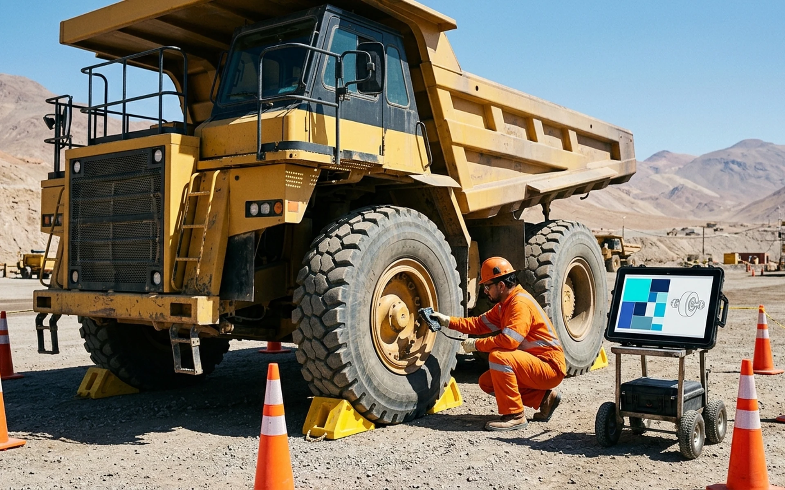
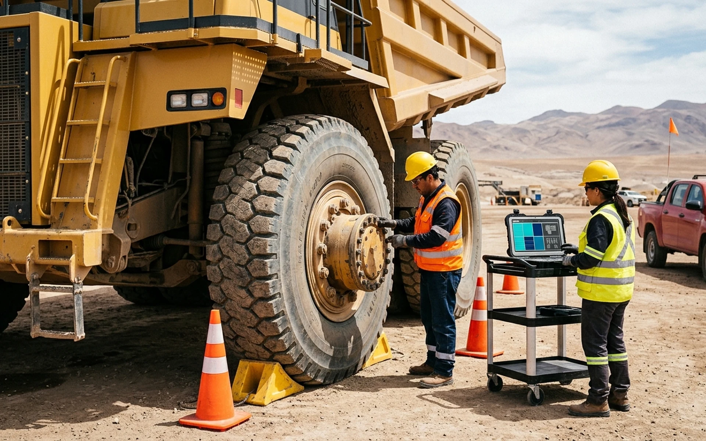

# BaseLogic EAM — QA técnica y selección visual V7/V8

Fecha de auditoría: 2026-07-22
Alcance: únicamente `eam-mining-hero-v7.webp` y `eam-mining-hero-v8.webp`
Método: inspección directa de los originales a 100%, barrido completo en cuatro cuadrantes a 200%, decodificación independiente, auditoría estática del visor y simulación exacta de crops 4:5 y 1:1.

## 1. Estado Git

Después de `git fetch origin --prune`, el repositorio está en `master` y alineado con remoto:

- `HEAD`: `f0aed1a348e9ab7cc39680df8eb2406410cc2dc4`.
- `origin/master`: `f0aed1a348e9ab7cc39680df8eb2406410cc2dc4`.
- El árbol local no está limpio; no había cambios staged.
- Modificados después del último push: `STATUS.md`, `EAM_MINING_VISUAL_REVIEW.md`, `eam-mining-hero-v5.webp`, `eam-mining-hero-v6.webp` y `review.html`.
- No rastreados al inicio de esta QA: `EAM_MINING_V5_V6_SELECTION_REVIEW.md`, V7 y V8.
- V7 y V8 son archivos nuevos no rastreados; no reemplazan un blob del commit actual.
- `review.html` cambia V1–V6 a V1–V8, actualiza metadatos de V5/V6 y agrega las tarjetas completas de V7/V8. Conserva `object-position: 50% 50%` para todos los crops.
- `EAM_MINING_VISUAL_REVIEW.md` se amplía a V1–V8. Sus afirmaciones sobre V7/V8 son declarativas y no deben tomarse como QA: contradicen el original al afirmar una pickup roja en V7, ausencia total de texto en V8 y preservación responsive con centrado 50/50.
- `STATUS.md` tenía cambios locales previos relativos a V5/V6; antes de este dictamen todavía no incluía V7/V8.
- `public/` no presenta cambios. El blob de trabajo y el blob de `HEAD` para `public/images/generated/products/eam-hero.webp` coinciden en `df832db3f04f6b193fe8fa1dc3e81206cf72943f`.
- No existe en `public/` ninguna ruta o archivo que contenga `eam-mining`, `batch-3` o `visual-review`.

El diff previo de Batch 3 era de cinco archivos rastreados: 146 inserciones, 36 eliminaciones y reemplazo binario local de V5/V6. Esta QA no modifica V1–V8, `public/`, `visualAssets.ts`, la página EAM, copy ni CTAs.

## 2. Verificación técnica

| Control | V7 | V8 |
|---|---:|---:|
| Formato detectado | WebP real, VP8 lossy | WebP real, VP8 lossy |
| Cabecera | `RIFF` + `WEBP` | `RIFF` + `WEBP` |
| Integridad RIFF | 420.092 bytes declarados y reales; cadena de chunks completa | 386.504 bytes declarados y reales; cadena de chunks completa |
| Chunks | un chunk `VP8 ` de 420.072 bytes | un chunk `VP8 ` de 386.484 bytes |
| Dimensiones | 1920×1200 px | 1920×1200 px |
| Ratio | 1,600000; 16:10 | 1,600000; 16:10 |
| Modo decodificado | RGB | RGB |
| Muestreo almacenado | YUV 4:2:0 | YUV 4:2:0 |
| Peso exacto | 420.092 bytes; 410,24609 KiB | 386.504 bytes; 377,44531 KiB |
| SHA-256 | `14b2c1b562e1fa98e5928f441dbc5aeed08d3c4e2df43e19611a592089ec5f47` | `f774c9a38e3fbe19b336853e103d7a2397575ac2736e25a331f7eb06ecc6c002` |
| Frames | 1; no animado | 1; no animado |
| Decodificación | `verify()` y carga total correctas | `verify()` y carga total correctas |
| Corrupción | no detectada | no detectada |

Los valores informados para dimensión, peso y hash eran correctos, pero fueron verificados de forma independiente. A 100% y 200% se conservan textura de metal, caucho, suelo, EPP, piel y equipos. No se observa posterización, banding fuerte, macroblocking ni compresión destructiva. V7 tiene un leve aspecto sobreenfocado en bordes finos; V8 conserva mejor microtextura, aunque su pseudo-texto es contenido generado en la imagen y no un artefacto de compresión.

## 3. Tabla de puntuaciones

La puntuación editorial no anula los descartes automáticos. Una variante puede obtener más puntos y seguir impedida por texto, pseudo-texto o marcas.

| Criterio | V7 | V8 |
|---|:---:|:---:|
| 1. Coherencia BaseLogic | 4 | 4 |
| 2. Pragmatismo Iluminado — Minería | 4 | 5 |
| 3. Fotorealismo | 4 | 4 |
| 4. Calidad editorial | 4 | 3 |
| 5. Calidad técnica | 5 | 4 |
| 6. Credibilidad mecánica | 4 | 4 |
| 7. Credibilidad minera chilena | 4 | 5 |
| 8. Representación de contratista | 3 | 5 |
| 9. Seguridad operacional | 4 | 4 |
| 10. EPP | 5 | 4 |
| 11. Anatomía | 5 | 5 |
| 12. Claridad EAM | 4 | 5 |
| 13. Tecnología integrada | 5 | 5 |
| 14. Ausencia de publicidad de fabricante | 5 | 2 |
| 15. Composición desktop | 4 | 5 |
| 16. Crop mobile 4:5 | 4 | 4 |
| 17. Crop 1:1 | 4 | 5 |
| 18. Impacto comercial | 4 | 5 |
| 19. Coherencia con Home, Booking y EAM actual | 4 | 4 |
| **Total / 95** | **80** | **82** |

## 4. Análisis V7

V7 comunica una inspección concreta: el mantenedor aplica un dispositivo secundario cableado sobre el cubo de la rueda y la tablet montada muestra bloques cian/navy junto con un esquema abstracto del componente. La relación componente–técnico–registro digital es observable; la tecnología no está flotando ni funciona como simple decoración.

El CAEX domina con fuerza y conserva tolva, cabina, plataformas, barandas, escaleras, chasis y ruedas en una vista casi completa. La textura de uso, el polvo moderado y la escala frente al trabajador son creíbles. El resultado no parece juguete y no presenta una pose publicitaria.

Limitaciones:

- No existe la pickup roja descrita para V7. Se ve un vehículo amarillo distante; por tanto no es posible validar parrilla, volante, tapas, puerta, portalón o patentes de una pickup roja. Es una desviación de la ficha, no un descarte automático del asset.
- La tablet es más grande que una tablet de terreno típica y se aproxima a un monitor rugerizado, pero está físicamente apoyada y funcionalmente vinculada al componente.
- El centrado responsive 50/50 corta la tablet en 4:5 y casi la elimina en 1:1. La imagen sí es recuperable con reposicionamiento, sin editar píxeles.
- La inmovilización se comunica con calzos y conos; no hay evidencia visual específica de aislamiento de energía o LOTO. En una fotografía fija puede confirmarse detención aparente, no el estado real del sistema.

Dictamen V7: **Aprobada para selección visual**. No implica integración pública.

## 5. Análisis V8

V8 es la escena más clara para EAM: el técnico inspecciona físicamente el cubo mientras la supervisora opera una tablet montada en un carro. Las acciones son diferentes, naturales y simultáneas; el componente, el registro y la supervisión forman una narrativa de orden de trabajo y trazabilidad más inmediata que V7.

El entorno es limpio, el carro está estable, la pickup roja es secundaria y ambos sujetos sobreviven en 4:5 si el foco se desplaza a la derecha. La tablet no es un holograma, no está sostenida frontalmente y mantiene perspectiva, soporte y escala plausibles.

Limitaciones y fallas:

- El neumático delantero contiene varias bandas de pseudo-lettering claramente visibles a 100% y 200%.
- El panel derecho de la tablet contiene grupos con apariencia de letras y números.
- El casco amarillo de la supervisora lleva una pequeña etiqueta o marca rectangular verdosa.
- El CAEX está cortado por el borde izquierdo y superior. La parte visible es coherente, pero el activo completo no puede certificarse desde este encuadre.
- El técnico toca el cubo con ambas manos, sin una herramienta de inspección tan inequívoca como la de V7; la supervisión digital compensa esa ambigüedad.
- Con centrado 50/50, el crop 4:5 excluye a la supervisora y casi toda la tablet. La falla se resuelve con `object-position`, no con regeneración.

Dictamen V8: **Candidata condicionada a edición localizada**. No es aprobable en su estado actual.

## 6. Marcas, texto y patentes

### V7

- CAEX, cabina, tolva, parrilla, barandas, escaleras, cubos, carro, ropa y herramienta: sin Toyota, CAT, Caterpillar, Komatsu, fabricante, emblema reconocible, número de equipo, texto o pseudo-texto.
- Neumáticos: sin lettering ni caracteres detectables.
- Tablet: bloques abstractos y diagrama de cubo; no hay caracteres.
- Conos: lisos, sin texto.
- Casco y ropa: sin logo reconocible. El óvalo oscuro lateral del casco se lee como detalle/soporte del casco, no como emblema.
- Pickup roja: ausente; no hay patente que validar.

### V8

- CAEX: sin logo o número de equipo reconocible en metal, cabina, tolva, escalera o cubo.
- Neumático delantero: pseudo-lettering en múltiples posiciones de la pared lateral; activa descarte automático de aprobación.
- Tablet: pseudo-caracteres en los módulos grises de la derecha; activa descarte automático de aprobación.
- Casco de la supervisora: etiqueta verdosa sin fabricante legible, pero constituye una marca en EPP y debe retirarse.
- Pickup roja: vista lateral, sin parrilla ni portalón visibles. No se ve patente, logo de puerta, emblema de tapa o fabricante reconocible. El volante no es visible.
- Conos, carro, ropa, guantes y herramientas: sin texto adicional detectado.

No aparece una marca Toyota, CAT, Caterpillar o Komatsu legible en ninguna de las dos variantes.

## 7. Mecánica del CAEX

### V7

- Activo de dos ejes coherente; rueda delantera y rueda trasera visibles, con ruedas opuestas parcialmente ocultas por perspectiva.
- Tolva, cabina, plataforma, barandas, acceso, chasis, suspensión en sombra, cubos y neumáticos mantienen continuidad física.
- Los neumáticos apoyan correctamente y la escala frente al mantenedor es plausible para un camión minero rígido de rango intermedio/alto, aunque no comunica la escala extrema de un CAEX de clase ultra.
- No se detectan fusiones estructurales, piezas suspendidas ni geometría imposible. Los peldaños inferiores son toscos, pero siguen siendo interpretables como acceso.

### V8

- La rueda y el cubo principal son más convincentes que en V7: pernos, brida y volumen del cubo tienen lectura de componente mantenible.
- Tolva, plataforma, escalera, chasis y suspensión visible son coherentes; la rueda posterior conserva posición plausible.
- No se observan partes fusionadas o apoyos imposibles.
- El encuadre no muestra el activo completo, por lo que no permite verificar extremo delantero, totalidad de cabina, tren posterior completo ni número total de neumáticos.

Ambas escenas resultan creíbles para mantenimiento minero; V7 entrega mejor evidencia del activo completo y V8 mejor evidencia del componente intervenido.

## 8. Acción EAM

| Relación observable | V7 | V8 |
|---|---|---|
| Componente inspeccionado | cubo/rueda, explícito | cubo/rueda, explícito |
| Técnico | inspección con dispositivo cableado | inspección manual del cubo |
| Tablet/registro | montada en carro, UI abstracta y esquema de componente | montada en carro, supervisora interactúa con ella |
| Dispositivo secundario | sí, instrumento de mano cableado | no claramente diferenciado |
| Orden de trabajo/trazabilidad | inferencia fuerte por vínculo herramienta–cubo–tablet | lectura directa por técnico + supervisora + tablet |
| Riesgo de decoratividad | bajo | muy bajo |

V7 es más fuerte como inspección técnica puntual. V8 es más fuerte como flujo colaborativo de orden de trabajo y seguimiento.

## 9. Seguridad

En ambas variantes el CAEX parece detenido, no hay personas bajo el equipo, no existen cargas suspendidas, no hay mangueras cruzando pasos y la pickup de V8 queda fuera de la zona inmediata de intervención. Los carros están sobre suelo firme y las herramientas se mantienen ordenadas.

V7 muestra calzos a ambos lados del neumático principal, calzos adicionales y una segregación más extensa con conos. El cable del instrumento queda contenido entre la mano y el cubo. V8 también muestra calzos y conos, aunque el perímetro es más abierto.

No hay una práctica evidentemente insegura que active descarte automático. La imagen solo permite verificar inmovilización visual mediante calzos y condición estática; no permite confirmar motor apagado, freno aplicado, llave controlada o aislamiento de energías.

## 10. EPP y anatomía

V7 presenta casco, protección ocular, guantes, overol de alta visibilidad con reflectantes y botas. Postura, brazos, manos, dedos, rostro y apoyo de pies son plausibles. El sujeto no mira a cámara.

V8 presenta casco, protección ocular, guantes, chalecos/ropa reflectante, pantalón largo y botas en ambos sujetos. Las manos del técnico se relacionan con el cubo y las de la supervisora con el carro/tablet. No se detectan dedos extra, manos fusionadas, brazos imposibles, rostros artificiales evidentes ni EPP fusionado. La pequeña etiqueta del casco de la supervisora es la única falla localizada de EPP.

## 11. QA responsive

La auditoría estática de `review.html` confirma:

- 8 tarjetas `article.card`.
- 8 originales, 8 crops 4:5 y 8 crops 1:1: 24 imágenes en total.
- Cada tarjeta contiene tres referencias al archivo correcto.
- Todas las rutas existen.
- Los ocho archivos son WebP de 1920×1200 y todos los pesos mostrados coinciden con el peso real redondeado a dos decimales.
- HTML balanceado: 8 aperturas/cierres de `article`, 1 de `section`, 106 de `div` y 16 de `figure`; no se detectaron cierres inesperados ni elementos no cerrados.
- Una sola sección y una sola grilla; no hay sección duplicada.
- El visor usa un único `object-position: 50% 50%`.

El navegador aislado no permitió navegar a `file://`; por ello no se afirma una prueba interactiva del visor. La equivalencia visual de crops se verificó directamente sobre los píxeles originales con las mismas relaciones de aspecto y el algoritmo geométrico de `object-fit: cover`.

### Resultado de los crops actuales

- V7 4:5 a 50/50: sobreviven CAEX, cubo y técnico, pero la tablet queda fuera. V7 1:1 a 50/50: la tablet queda casi totalmente fuera.
- V8 4:5 a 50/50: sobreviven CAEX, cubo y técnico, pero la supervisora queda fuera y la tablet apenas entra. V8 1:1 a 50/50: la tablet entra parcialmente y la supervisora queda cortada.

### `object-position` recomendado

| Variante | Desktop 16:10 | Mobile 4:5 | 1:1 |
|---|---|---|---|
| V7 | `50% 50%` | `80% 50%` | `72% 50%` |
| V8 | `50% 50%` | `80% 50%` | `72% 50%` |

Con 80% en 4:5 sobreviven el cubo, el técnico, la tablet y suficiente CAEX. En V8 también sobrevive la supervisora; la pickup puede salir del encuadre. El centrado global 50/50 del visor es un defecto objetivo para V7/V8, pero no se modificó durante esta QA.

## 12. Comparación comercial

| Audiencia | Mejor dirección | Motivo |
|---|---|---|
| Contratistas de mantenimiento | V8 condicionada | muestra ejecución técnica, supervisión y orden de trabajo en una sola lectura |
| Movimiento de tierra | V7 | muestra con mayor fuerza el activo completo y la inspección puntual de alto tonelaje |
| Empresas de apoyo a minería | V8 condicionada | incorpora equipo humano, estación móvil y pickup secundaria |
| Operadores de flotas pesadas | V7 | prioriza condición del componente, inmovilización y disponibilidad del activo |

V8 tiene mayor potencial comercial general y mayor claridad EAM. V7 es la mejor opción utilizable hoy porque mantiene fuerza minera, inspección concreta, registro digital y cumplimiento de exclusiones.

## 13. Descartes automáticos

- **V7:** no activa descarte automático. No se detectan logos, fabricantes, patentes, texto, pseudo-texto, lettering de neumático, inseguridad evidente ni fallas anatómicas graves.
- **V8:** activa bloqueo automático de aprobación por pseudo-lettering en el neumático, pseudo-caracteres en la tablet y marca en el casco. No activa descarte por mecánica, seguridad o anatomía.

El bloqueo de V8 aplica al archivo actual; no obliga a abandonar la dirección completa porque las fallas están confinadas a superficies localizadas.

## 14. Candidatas condicionadas

**V8 — Candidata condicionada a edición localizada.** Cumple en mecánica visible, seguridad, anatomía, acción EAM, composición y crops con reposicionamiento. Debe volver a QA a 100% y 200% después de limpiar las tres áreas indicadas.

V7 no queda condicionada. La ausencia de pickup reduce representación de contratista, pero no introduce una marca, patente, texto, riesgo operacional ni incoherencia estructural.

## 15. Ediciones localizadas posibles

No se editó ninguna imagen durante esta QA.

| Área V8 | Coordenadas aproximadas en 1920×1200 | Reemplazo requerido | Riesgo | Viabilidad con Nano Banana |
|---|---|---|---|---|
| Pared lateral del neumático delantero | máscara anular dentro de `x≈560–1030`, `y≈410–1040`; excluir tread y cubo | caucho usado uniforme, sin letras, números ni glifos | medio-alto por curvatura, grano y cercanía al cubo | posible con máscara ceñida; exige revisar que no cambie tread, pernos, diámetro o sombras |
| Panel derecho de la tablet | `x≈1480–1545`, `y≈600–710` | bloques navy/cian/gris completamente abstractos | bajo | sí; no debería alterar bezel, soporte, manos ni perspectiva |
| Etiqueta del casco de la supervisora | `x≈1620–1650`, `y≈472–500` | plástico amarillo continuo con la misma luz | bajo-medio | sí; conservar volumen, borde y reflejo del casco |

Agregar una pickup roja a V7 no sería una edición localizada de limpieza; alteraría composición y perspectiva. No se recomienda hacerlo como retoque.

## 16. Variante recomendada

**V7 es la variante recomendada y aprobada para selección visual.** Es la única que no infringe los descartes automáticos y mantiene una relación creíble entre componente, mantenedor, dispositivo de inspección y registro digital.

V8 queda como dirección comercial preferente para una eventual edición localizada, pero no debe reemplazar el dictamen de V7 mientras conserve pseudo-texto y la marca de EPP.

## 17. `object-position`

Para una eventual implementación separada de V7:

- Desktop 16:10: `50% 50%`.
- Mobile 4:5: `80% 50%`.
- Card 1:1: `72% 50%`.

El componente, el mantenedor y la tablet sobreviven con esos focos. La misma recomendación geométrica funciona para V8 después de su edición localizada. El modelo actual de `visualAssets.ts` admite una sola posición; como desktop usa el ratio nativo 16:10, `80% 50%` no produce recorte horizontal allí, pero cualquier integración debe verificarse en el componente real.

## 18. Peso y optimización futura

V7 pesa 410,25 KiB y V8 377,45 KiB. Son pesos razonables para revisión maestra a 1920×1200, pero altos frente al EAM público actual de 124,98 KiB. Antes de una futura integración conviene explorar una reducción aproximada de 15–25% y volver a revisar a 100%/200%, especialmente caucho, reflectantes, rostro, suelo y líneas del carro. No se recomienda perseguir el peso del asset público actual si ello elimina textura o introduce posterización.

No se realizó recompresión ni optimización durante esta QA.

## 19. Próximo paso

Mantener V7 como selección aprobada fuera de `public/`. Si se decide continuar con V8, ejecutar únicamente las tres ediciones localizadas descritas y repetir esta misma QA antes de aprobarla. Toda optimización, integración pública, cambio de `visualAssets.ts`, build, commit, push o deploy debe quedar para una tarea separada y explícitamente autorizada.

Aprobar EAM Minería V7
